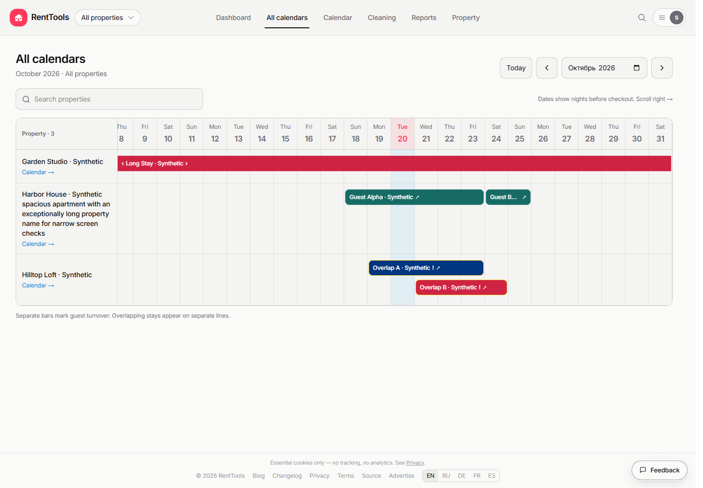

# Monthly property calendar: review evidence

This directory contains the 25 review artifacts captured on 21 October 2026:
15 screenshots, six JSON reports, two verification reports, and two source patches.
The screenshots use synthetic properties, guests, and reservations.

The original calendar implementation is commit
`9e8dee2c92cb11a98e95b58502d6790fdb8e9c9d`; the separate Vite security patch is
`4ff9f566f09200885fd251472f77ed7f952dad8e`. The review branch also includes the
unchanged blog update from `a6ca4e94a2518095eb41fe3a68f27409e494c4a4`.

## Desktop preview

[Open the full desktop screenshot](overview-desktop-october.png).

## Screenshots

| Scenario | Evidence |
| --- | --- |
| Desktop October overview | [Desktop](overview-desktop-october.png) |
| Mobile controls and dates | [Controls](overview-mobile-top.png), [scrolled dates](overview-mobile-october.png) |
| Russian mobile interface | [Russian](overview-mobile-russian.png) |
| Frozen mobile header and property names | [Sticky header](overview-mobile-sticky.png) |
| Separate guests sharing a checkout/check-in date | [January turnover](overview-january-turnover.png) |
| Existing reservation card | [Reservation card](overview-reservation-card.png) |
| Stay crossing the year boundary | [Year clipping](overview-year-clipping.png) |
| Loading, failure, and retry | [Loading](overview-loading.png), [error](overview-error.png), [retry](overview-retry.png) |
| Properties without stays this month | [Empty occupancy](overview-empty-occupancy.png) |
| Search with no matches | [No results](overview-no-results.png) |
| Zero or one accessible property | [Zero properties](overview-zero-properties.png), [one property](overview-one-properties.png) |

## Reports and patches

- [Calendar verification](verification.md) and [18-group browser report](browser-report.json).
- [Publication verification](publication-verification.json): source parity, repeated local checks, and screenshot hashes.
- [Dependency verification](dependency-fix-verification.md), [structured dependency results](dependency-fix-results.json), and [clean audit](npm-audit-after-vite.json).
- [Blog compatibility hashes](master-blog-compatibility.json) and [earlier master CI diagnosis](master-ci-jobs.json).
- [Original calendar patch](renttools-portfolio-calendar.patch) and [Vite patch](renttools-vite-audit-fix.patch).
- [Historical screenshot delivery status](screenshot-delivery-status.json).

The captured reports describe their original verification phase. In particular,
the earlier master CI failure predates the dependency patch, and publication flags
in historical JSON reports refer to the time those reports were captured.
Local filesystem paths and personal delivery details were removed from the public
copies of the written reports; the screenshots and source patches are unchanged.
The current branch and pull-request checks determine its publication readiness.
